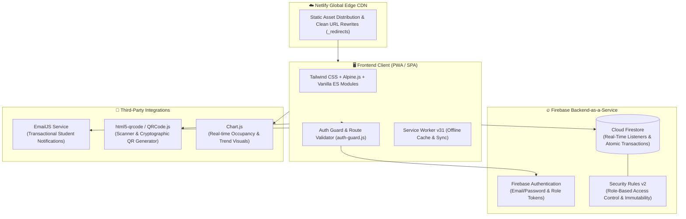
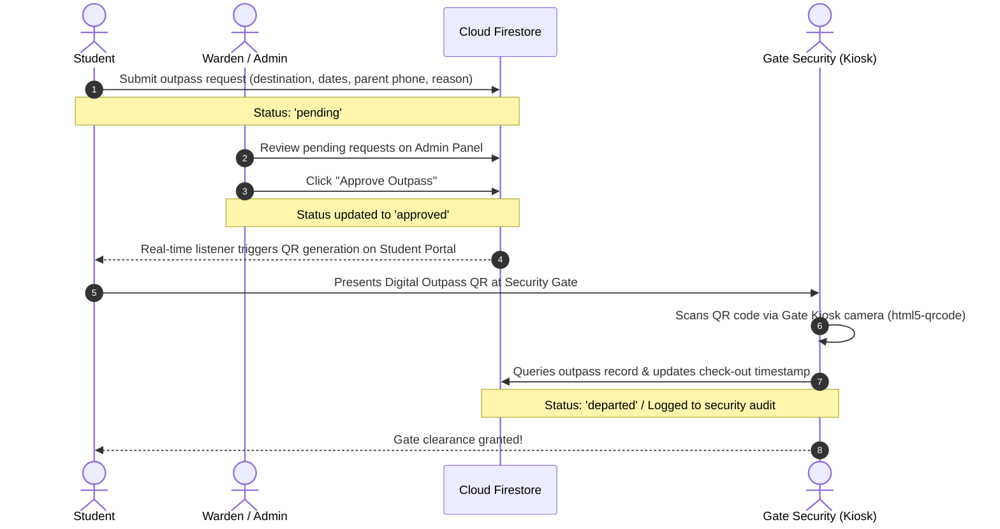
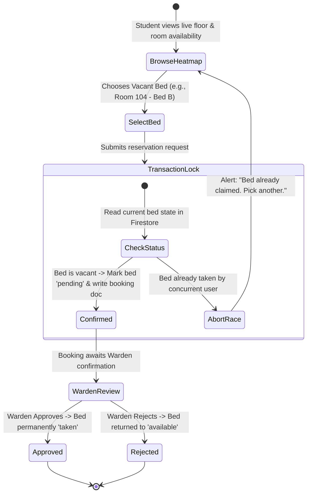
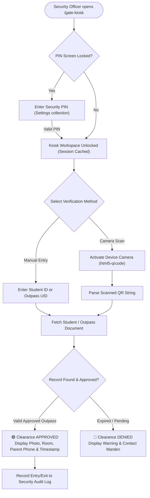

<p align="center">
  
</p>

<h1 align="center">🏨 NBKRIST Hostel Portal</h1>

<p align="center">
  <b>A modern, serverless, mobile-responsive hostel management ecosystem.</b><br/>
  <sub>Real-Time Firestore Sync • Atomic Double-Booking Protection • Cryptographic QR Gate Passes • Glassmorphism UI</sub>
</p>

<p align="center">
  <a href="https://nbkristhostelportal.netlify.app/"></a>
  <a href="https://nbkristhostelportal.netlify.app/"></a>
  <a href="https://app.netlify.com/start/deploy?repository=https://github.com/likhith3035/hostel-portal-2"></a>
</p>

<p align="center">
  
  
  
  
  
  
  
</p>

<p align="center">
  <a href="https://github.com/likhith3035/hostel-portal-2/stargazers"></a>
  <a href="https://github.com/likhith3035/hostel-portal-2/network/members"></a>
  <a href="https://github.com/likhith3035/hostel-portal-2/issues"></a>
</p>

> [!NOTE]
> **Academic Project Disclaimer:** This platform is an independent student academic project engineered for learning and demonstration purposes. It is **NOT** the official web portal of NBKR Institute of Science and Technology (NBKRIST).

---

## 📑 Table of Contents

- [Overview](#-overview)
- [Why NBKRIST Hostel Portal?](#-why-nbkrist-hostel-portal)
- [System Architecture](#-system-architecture)
- [Key Workflows & Data Flows](#-key-workflows--data-flows)
  - [1. Digital Outpass & Gate Verification](#1-digital-outpass--gate-verification-workflow)
  - [2. Atomic Room Booking with Concurrency Protection](#2-atomic-room-booking-flow)
  - [3. Dedicated Gate Kiosk & Scanner Flow](#3-dedicated-gate-kiosk--scanner-flow)
- [Feature Matrix by Role](#-feature-matrix-by-role)
  - [Student Portal](#-student-portal)
  - [Admin & Warden Command Center](#-admin--warden-command-center)
  - [Security & Gate Kiosk](#-security--gate-kiosk)
- [UI / UX Design Highlights](#-ui--ux-design-highlights)
- [Repository Structure](#-repository-structure)
- [Database Schema & Security Architecture](#-database-schema--security-architecture)
- [Quick Start & Local Setup](#-quick-start--local-setup)
- [Configuration Reference](#-configuration-reference)
- [Production Deployment](#-production-deployment)
- [Progressive Web App (PWA) & Cache Management](#-progressive-web-app-pwa--cache-management)
- [Troubleshooting & FAQs](#-troubleshooting--faqs)
- [Roadmap](#-roadmap)
- [Contributing](#-contributing)
- [Developer & Institutional Credits](#-developer--institutional-credits)
- [License](#-license)

---

## 🌟 Overview

The **NBKRIST Hostel Portal** is a production-ready, full-stack serverless web application engineered to replace archaic paper-based hostel administration with a fast, transparent, and mobile-responsive digital hub.

Built on the **JAMstack** philosophy, the portal operates without a dedicated backend server by leveraging **Firebase modular services** (Authentication, Cloud Firestore real-time listeners, and atomic transactions) backed by an Edge CDN (Netlify) and client-side route guards.

### 🎯 Primary Capabilities
- 🛏️ **Visual Bed Heatmap**: Real-time room vacancy visualization with atomic transaction-safe reservation to prevent double-booking.
- 🎫 **Digital Outpass Engine**: Streamlined outpass request workflow with warden approvals and dynamically signed QR codes for gate check-in/out.
- 🛂 **Dedicated Gate Kiosk & ID Checker**: Touch-friendly, high-contrast kiosk mode with camera QR scanning (`html5-qrcode`) and manual fallback.
- 🍽️ **Smart Mess Schedule**: Automated 7-day meal schedule with countdown timers to the next meal and student satisfaction ratings.
- 📝 **Complaint Resolution Hub**: Transparent ticketing for room, mess, Wi-Fi, and electrical maintenance with real-time status tracking.
- 🪪 **Digital Student Identity Card**: Instant digital identification with barcode, secure verification QR, and photo flip view.
- 🛡️ **Comprehensive Admin Suite**: Chart.js analytics, student directory management, bulk actions, user archival/restore, immutable audit trails, and EmailJS communication.

---

## 💡 Why NBKRIST Hostel Portal?

Traditional hostel management relies on handwritten logbooks, paper outpass slips, physical bulletin boards, and manual room allocation ledgers. This creates inefficiencies, lost paperwork, delays at the security gate, and lack of accountability.

| Challenge in Traditional Hostels | NBKRIST Hostel Portal Solution |
| :--- | :--- |
| **Paper Outpass Delays** | ⚡ Instant digital application, warden one-click approval, and sub-second QR code scan at the gate. |
| **Double-Booking & Allotment Bias** | 🔒 Interactive room vacancy heatmap backed by **Firestore Transactions** to guarantee atomic room locks. |
| **Lost or Damaged ID Cards** | 🪪 Web-based **Digital Student ID** accessible anywhere on smartphone with verifiable QR payload. |
| **Unaddressed Complaints** | 📊 Transparent grievance redressal tracking (`Pending` ➔ `In Progress` ➔ `Resolved`). |
| **Static & Forgotten Mess Timetables** | 🕒 Dynamic 7-day timetable that auto-highlights the current meal with a live countdown timer. |
| **Manual Gate Logs & Night Bottlenecks** | 📱 Dedicated **Gate Kiosk** (`gate-kiosk.html`) optimized for low-light camera QR scanning with live security logs. |
| **Server Maintenance Costs** | ☁️ **100% Serverless**: Zero cloud server costs, near-infinite scalability, and instantaneous Edge CDN delivery. |

---

## 🏗️ System Architecture

The architecture follows a decoupled, secure **Serverless JAMstack** topology:



---

## 🔄 Key Workflows & Data Flows

### 1. Digital Outpass & Gate Verification Workflow



---

### 2. Atomic Room Booking Flow

To prevent race conditions where two students apply for the same bed at the exact same millisecond, room reservations run inside **Firestore atomic transactions**:



---

### 3. Dedicated Gate Kiosk & Scanner Flow



---

## 📊 Feature Matrix by Role

### 🎓 Student Portal

| Feature | File | Description |
| :--- | :--- | :--- |
| **Real-Time Dashboard** | [`index.html`](file:///c:/Users/kamil/OneDrive/Desktop/hsp2%20backup/index.html) | Live summary of current meal countdown, recent notices, and personal complaint statuses. |
| **Room Booking Heatmap** | [`booking.html`](file:///c:/Users/kamil/OneDrive/Desktop/hsp2%20backup/booking.html) | Interactive floor map showing live room & bed status (Available, Pending, Taken) with atomic booking. |
| **Digital Outpass** | [`outpass.html`](file:///c:/Users/kamil/OneDrive/Desktop/hsp2%20backup/outpass.html) | Submit leave/outpass requests, view approval status, and display verified QR code for gate check. |
| **7-Day Dynamic Mess Menu** | [`mess-menu.html`](file:///c:/Users/kamil/OneDrive/Desktop/hsp2%20backup/mess-menu.html) | Weekly meal calendar, automatic time-based meal highlighting, and interactive meal rating system. |
| **Grievance Redressal** | [`complaints.html`](file:///c:/Users/kamil/OneDrive/Desktop/hsp2%20backup/complaints.html) | Submit tickets for electrical, plumbing, Wi-Fi, or food issues with real-time status updates. |
| **Digital Identity Card** | [`id-card.html`](file:///c:/Users/kamil/OneDrive/Desktop/hsp2%20backup/id-card.html) | Official-style digital student ID with barcode, personal details, photo, and verification QR code. |
| **Profile & Settings** | [`profile.html`](file:///c:/Users/kamil/OneDrive/Desktop/hsp2%20backup/profile.html) | Manage student bio, avatar, emergency contacts, room allocation details, and password security. |
| **Campus Regulations** | [`rules.html`](file:///c:/Users/kamil/OneDrive/Desktop/hsp2%20backup/rules.html) | Official hostel timings, disciplinary policies, mess guidelines, and ragging prohibition protocols. |

---

### 🛡️ Admin & Warden Command Center

| Feature | Location | Description |
| :--- | :--- | :--- |
| **Executive Analytics** | [`admin.html`](file:///c:/Users/kamil/OneDrive/Desktop/hsp2%20backup/admin.html) | Real-time KPI cards, hostel occupancy donut chart, and complaint categories breakdown via **Chart.js**. |
| **Room Allocation Control** | [`admin.html`](file:///c:/Users/kamil/OneDrive/Desktop/hsp2%20backup/admin.html) | Review bed booking applications, execute atomic approve/reject decisions, and perform forced room vacates. |
| **Outpass Approval Hub** | [`admin.html`](file:///c:/Users/kamil/OneDrive/Desktop/hsp2%20backup/admin.html) | Filter outpasses by status (`pending`, `approved`, `expired`), approve requests, or revoke permissions. |
| **Student Directory & Export** | [`admin.html`](file:///c:/Users/kamil/OneDrive/Desktop/hsp2%20backup/admin.html) | Search, filter by branch/room, promote roles, and export complete student rosters to CSV. |
| **User Archival & Restore** | [`admin.html`](file:///c:/Users/kamil/OneDrive/Desktop/hsp2%20backup/admin.html) | Soft-delete student records into `deletedUsers` collection with complete one-click restoration. |
| **Mess Menu Live Editor** | [`admin.html`](file:///c:/Users/kamil/OneDrive/Desktop/hsp2%20backup/admin.html) | Modify daily breakfast, lunch, snacks, and dinner items with immediate propagation to all students. |
| **Campus Broadcast Notices** | [`admin.html`](file:///c:/Users/kamil/OneDrive/Desktop/hsp2%20backup/admin.html) | Publish critical alerts, notices, and announcements with date-based priority. |
| **Email Communication** | [`admin.html`](file:///c:/Users/kamil/OneDrive/Desktop/hsp2%20backup/admin.html) | Dispatch direct notifications and broadcast reminders to students using the integrated **EmailJS** service. |
| **Gate Passcode Manager** | [`admin.html`](file:///c:/Users/kamil/OneDrive/Desktop/hsp2%20backup/admin.html) | Manage and rotate gate kiosk access passcodes with persistent history tracking in `settings/gateKiosk`. |
| **Immutable Audit Logs** | [`admin.html`](file:///c:/Users/kamil/OneDrive/Desktop/hsp2%20backup/admin.html) | Security log inspector tracking admin approvals, role adjustments, room vacates, and user modifications. |

---

### 🛂 Security & Gate Kiosk

| Feature | Location | Description |
| :--- | :--- | :--- |
| **Gate Kiosk Interface** | [`gate-kiosk.html`](file:///c:/Users/kamil/OneDrive/Desktop/hsp2%20backup/gate-kiosk.html) | High-contrast, dark-mode terminal engineered for outdoor, night-time, and tablet/mobile gate operations. |
| **PIN Lock Protection** | [`js/gate-kiosk.js`](file:///c:/Users/kamil/OneDrive/Desktop/hsp2%20backup/js/gate-kiosk.js) | Prevents unauthorized tampering; gate personnel authenticate using a centralized security passcode. |
| **Camera QR Scanner** | [`gate-kiosk.html`](file:///c:/Users/kamil/OneDrive/Desktop/hsp2%20backup/gate-kiosk.html) | Instant QR barcode scanning leveraging `html5-qrcode` with live video stream overlay. |
| **Public ID Checker** | [`id-checker.html`](file:///c:/Users/kamil/OneDrive/Desktop/hsp2%20backup/id-checker.html) | Lightweight standalone scanner to authenticate any student's digital identity card by QR or roll number. |
| **Automatic Timestamping** | [`js/gate-kiosk.js`](file:///c:/Users/kamil/OneDrive/Desktop/hsp2%20backup/js/gate-kiosk.js) | Automatically logs exact check-out and check-in timestamps to Firestore upon successful verification. |

---

## 🎨 UI / UX Design Highlights

The portal's visual architecture is crafted to feel like a modern native iOS/macOS application rather than an academic tool:

- **Glassmorphism Design System**: Translucent frosted panels (`backdrop-blur-xl`), soft border reflections, and layered elevation shadows.
- **Dynamic Theme Engine**: Persistent Dark Mode and Light Mode with system-preference auto-detection (`prefers-color-scheme`).
- **Tactile Micro-Interactions**: Spring-click physics, floating animations, skeleton loaders during network latency, and non-blocking toast alerts.
- **Mobile-First Layout**: Fully responsive fluid grid layouts tailored for smartphone screens, tablets, kiosks, and widescreen monitors.
- **High-Accessibility Design**: High-contrast typography with [Plus Jakarta Sans](https://fonts.google.com/specimen/Plus+Jakarta+Sans) and semantic HTML5 structures.

---

## 🛠️ Tech Stack

<table>
  <tr>
    <th align="left">Category</th>
    <th align="left">Technology</th>
  </tr>
  <tr>
    <td><b>🎨 Frontend</b></td>
    <td>
      
      
      
      
    </td>
  </tr>
  <tr>
    <td><b>☁️ Backend</b></td>
    <td>
      
      
      
    </td>
  </tr>
  <tr>
    <td><b>📦 Libraries</b></td>
    <td>
      
      
      
      
      
      
      
    </td>
  </tr>
</table>

---

## 📂 Project Structure

```bash
hostel-portal-2/
│
├── 🔑 firebase-config.example.js   # ⬅️ Copy → firebase-config.js & add keys
│
├── 📄 index.html                    # Student Dashboard
├── 📄 admin.html                    # Admin Control Panel
├── 📄 login.html                    # Authentication Page
├── 📄 booking.html                  # Room Booking (Heatmap)
├── 📄 outpass.html                  # Outpass System (QR Codes)
├── 📄 mess-menu.html                # Mess Menu & Ratings
├── 📄 complaints.html               # Complaint System
├── 📄 profile.html                  # Student Profile & Digital ID
├── 📄 gate-kiosk.html               # Security Gate Interface
│
├── 📁 js/
│   ├── 📁 auth/                     # Auth handlers & guards
│   ├── 📁 firebase/                 # Firebase SDK wrappers
│   ├── 📁 core/                     # DB services & constants
│   ├── 📁 security/                 # Encryption & audit utils
│   ├── 📁 components/               # Reusable UI components
│   ├── admin.js                     # Admin logic (80KB+)
│   ├── booking.js                   # Room booking logic
│   ├── outpass.js                   # Outpass logic
│   └── mess-menu.js                 # Mess menu logic
│
├── 📁 css/                          # Stylesheets
├── 📁 assets/                       # Images & icons
└── .gitignore
```

---

## ⚙️ Installation & Setup

### Prerequisites

| Requirement | Details |
|-------------|---------|
| 🔥 Firebase Account | Free tier works — [Sign up here](https://firebase.google.com/) |
| 💻 Code Editor | VS Code recommended |
| 🌐 Local Server | Live Server extension, Python, or Node.js |

### Step 1 — Clone

```bash
git clone https://github.com/likhith3035/hostel-portal-2.git
cd hostel-portal-2
```

### Step 2 — Firebase Setup

1. Create a project at [Firebase Console](https://console.firebase.google.com/)
2. Enable **Authentication** → Sign-in method → **Email/Password**
3. Enable **Cloud Firestore** → Create database → **Test mode**

### Step 3 — Configure Keys

```bash
# Copy the example config
cp firebase-config.example.js firebase-config.js        # Mac/Linux
copy firebase-config.example.js firebase-config.js      # Windows
```

Open `firebase-config.js` and paste your Firebase keys:

```javascript
const firebaseConfig = {
  apiKey: "YOUR_API_KEY",                    // ← from Firebase Console
  authDomain: "YOUR_PROJECT.firebaseapp.com",
  projectId: "YOUR_PROJECT_ID",
  storageBucket: "YOUR_PROJECT.appspot.com",
  messagingSenderId: "YOUR_SENDER_ID",
  appId: "YOUR_APP_ID",
  measurementId: "YOUR_MEASUREMENT_ID"
};
```


### Step 3.1 — EmailJS Setup (Optional)

This project uses **EmailJS** for sending emails without a backend server.

1.  Create an account at [EmailJS](https://www.emailjs.com/).
2.  Create a **Service** (e.g., Gmail).
3.  Create an **Email Template**.
4.  Update the Public Key in `js/admin.js` and `js/outpass.js` where `emailjs.init()` is called.

```javascript
emailjs.init("YOUR_PUBLIC_KEY");
```

---

### Step 4 — Launch

| Method | Command |
|--------|---------|
| 🟢 **VS Code** | Right-click `index.html` → Open with Live Server |
| 🐍 **Python** | `python -m http.server 8000` |
| 🟩 **Node.js** | `npx serve .` |

### Step 5 — Open

Navigate to `http://localhost:8000` — You're all set! 🎉

---

## 🚀 Deployment

The easiest way to deploy this project is with **Netlify**.

### Option 1: Drag & Drop (Recommended)
1.  Go to [Netlify Drop](https://app.netlify.com/drop).
2.  Drag the `hostel-portal-2` folder onto the page.
3.  **Done!** Your site is live. 

> [!IMPORTANT]  
> Remember to add your Netlify domain (e.g., `https://your-site.netlify.app`) to **Firebase Console → Authentication → Settings → Authorized Domains** to allow sign-ins.

### Option 2: Netlify CLI
```bash
npm install netlify-cli -g
netlify login
netlify deploy --prod
```

### Option 3: Vercel / GitHub Pages
- **Vercel**: Install Vercel CLI or import from GitHub.
- **GitHub Pages**: Not recommended for this specific setup due to SPA routing with history API, but possible with configuration.

---

## 🔮 Roadmap

- [ ] **Push Notifications**: Real-time alerts for outpass approvals.
- [ ] **Parent Portal**: Dedicated login for parents to view attendance and expenses.
- [ ] **Payment Gateway**: Integration for hostel fee payments.
- [ ] **AI Chatbot**: For answering common student queries regarding rules and mess.

---

## ❓ Troubleshooting

| Issue | Solution |
|-------|----------|
| **White Screen / No Data** | Check your internet connection and ensure Firestore rules allow read access. |
| **Login Fails** | Verify that you have created an account in the Authentication tab of Firebase Console. |
| **Map Not Loading** | Ensure `booking.js` is correctly linked and your browser supports SVG rendering. |

---

## 📈 Star History

<p align="center">
  <a href="https://star-history.com/#likhith3035/hostel-portal-2&Date">
    
  </a>
</p>

---

## 🤝 Contributing


Contributions are welcome! Here's how:

```bash
# 1. Fork & Clone
git clone https://github.com/YOUR_USERNAME/hostel-portal-2.git

# 2. Create a branch
git checkout -b feature/AmazingFeature

# 3. Make your changes & commit
git commit -m "Add some AmazingFeature"

# 4. Push & open a PR
git push origin feature/AmazingFeature
```

---

## ✨ Contributors

<a href="https://github.com/likhith3035/hostel-portal-2/graphs/contributors">
  
</a>

---

## 👨‍💻 Developer

<p align="center">
  <b>Likhith Kami</b><br/>
  <sub>NBKRIST — AI & Data Science Department</sub>
</p>

<p align="center">
  <a href="https://github.com/likhith3035">
    
  </a>
  <a href="https://www.linkedin.com/in/likhith-kami/">
    
  </a>
  <a href="https://www.instagram.com/lucky__likhith?igsh=bTgxYjZtZ2wwYmR4">
    
  </a>
</p>

---

<p align="center">
  <sub>Built with ❤️ for NBKRIST Students</sub><br/><br/>
  
  
  
</p>

<p align="center">
  <sub>⭐ Star this repo if you found it useful!</sub>
</p>

---

## 📄 License

This project is licensed under the **MIT License**.

```text
MIT License

Copyright (c) 2025 Likhith Kami

Permission is hereby granted, free of charge, to any person obtaining a copy
of this software and associated documentation files (the "Software"), to deal
in the Software without restriction, including without limitation the rights
to use, copy, modify, merge, publish, distribute, sublicense, and/or sell
copies of the Software, and to permit persons to whom the Software is
furnished to do so, subject to the following conditions:

The above copyright notice and this permission notice shall be included in all
copies or substantial portions of the Software.

THE SOFTWARE IS PROVIDED "AS IS", WITHOUT WARRANTY OF ANY KIND, EXPRESS OR
IMPLIED, INCLUDING BUT NOT LIMITED TO THE WARRANTIES OF MERCHANTABILITY,
FITNESS FOR A PARTICULAR PURPOSE AND NONINFRINGEMENT. IN NO EVENT SHALL THE
AUTHORS OR COPYRIGHT HOLDERS BE LIABLE FOR ANY CLAIM, DAMAGES OR OTHER
LIABILITY, WHETHER IN AN ACTION OF CONTRACT, TORT OR OTHERWISE, ARISING FROM,
OUT OF OR IN CONNECTION WITH THE SOFTWARE OR THE USE OR OTHER DEALINGS IN THE
SOFTWARE.
```
