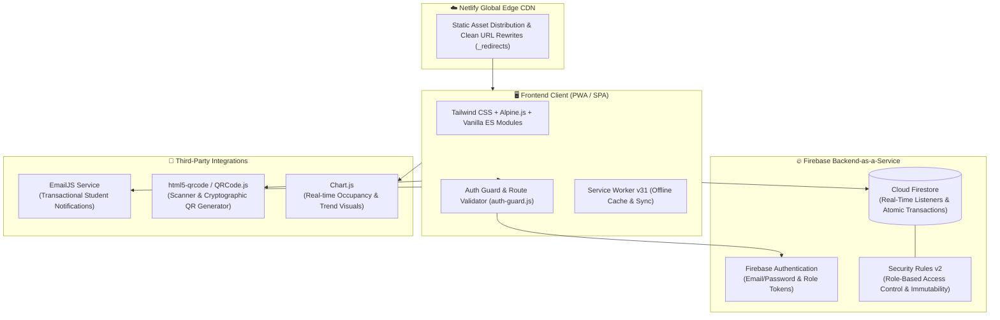
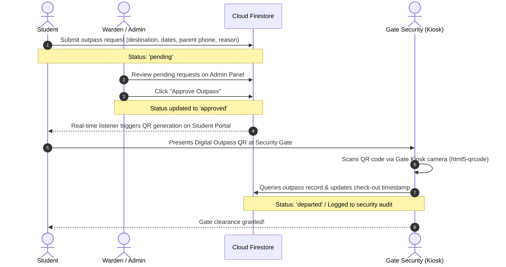
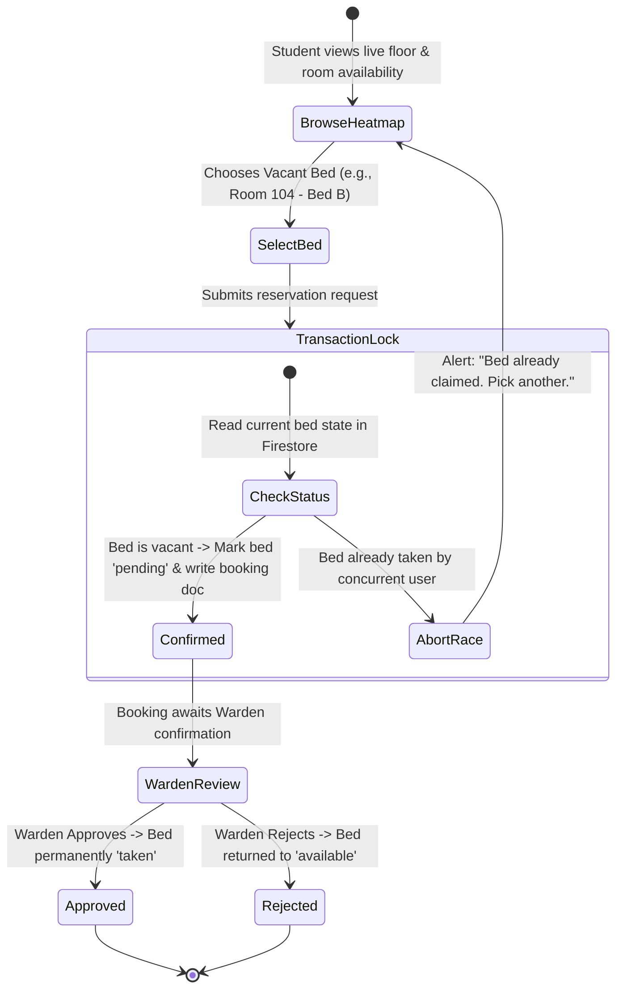

<p align="center">
  
</p>

<h1 align="center">🏨 NBKRIST Hostel Portal</h1>

<p align="center">
  <b>A modern, serverless, mobile-responsive hostel management ecosystem.</b><br/>
  <sub>Real-Time Firestore Sync • Atomic Double-Booking Protection • Cryptographic QR Gate Passes • Glassmorphism UI</sub>
</p>

<p align="center">
  <a href="https://nbkristhostelportal.netlify.app/"></a>
  <a href="https://nbkristhostelportal.netlify.app/"></a>
  <a href="https://app.netlify.com/start/deploy?repository=https://github.com/likhith3035/hostel-portal-2"></a>
</p>

<p align="center">
  
  
  
  
  
  
  
</p>

<p align="center">
  <a href="https://github.com/likhith3035/hostel-portal-2/stargazers"></a>
  <a href="https://github.com/likhith3035/hostel-portal-2/network/members"></a>
  <a href="https://github.com/likhith3035/hostel-portal-2/issues"></a>
</p>

> [!NOTE]
> **Academic Project Disclaimer:** This platform is an independent student academic project engineered for learning and demonstration purposes. It is **NOT** the official web portal of NBKR Institute of Science and Technology (NBKRIST).

---

## 📑 Table of Contents

- [Overview](#-overview)
- [Why NBKRIST Hostel Portal?](#-why-nbkrist-hostel-portal)
- [System Architecture](#-system-architecture)
- [Key Workflows & Data Flows](#-key-workflows--data-flows)
  - [1. Digital Outpass & Gate Verification](#1-digital-outpass--gate-verification-workflow)
  - [2. Atomic Room Booking with Concurrency Protection](#2-atomic-room-booking-flow)
  - [3. Dedicated Gate Kiosk & Scanner Flow](#3-dedicated-gate-kiosk--scanner-flow)
- [Feature Matrix by Role](#-feature-matrix-by-role)
  - [Student Portal](#-student-portal)
  - [Admin & Warden Command Center](#-admin--warden-command-center)
  - [Security & Gate Kiosk](#-security--gate-kiosk)
- [UI / UX Design Highlights](#-ui--ux-design-highlights)
- [Repository Structure](#-repository-structure)
- [Database Schema & Security Architecture](#-database-schema--security-architecture)
- [Quick Start & Local Setup](#-quick-start--local-setup)
- [Configuration Reference](#-configuration-reference)
- [Production Deployment](#-production-deployment)
- [Progressive Web App (PWA) & Cache Management](#-progressive-web-app-pwa--cache-management)
- [Troubleshooting & FAQs](#-troubleshooting--faqs)
- [Roadmap](#-roadmap)
- [Contributing](#-contributing)
- [Developer & Institutional Credits](#-developer--institutional-credits)
- [License](#-license)

---

## 🌟 Overview

The **NBKRIST Hostel Portal** is a production-ready, full-stack serverless web application engineered to replace archaic paper-based hostel administration with a fast, transparent, and mobile-responsive digital hub.

Built on the **JAMstack** philosophy, the portal operates without a dedicated backend server by leveraging **Firebase modular services** (Authentication, Cloud Firestore real-time listeners, and atomic transactions) backed by an Edge CDN (Netlify) and client-side route guards.

### 🎯 Primary Capabilities
- 🛏️ **Visual Bed Heatmap**: Real-time room vacancy visualization with atomic transaction-safe reservation to prevent double-booking.
- 🎫 **Digital Outpass Engine**: Streamlined outpass request workflow with warden approvals and dynamically signed QR codes for gate check-in/out.
- 🛂 **Dedicated Gate Kiosk & ID Checker**: Touch-friendly, high-contrast kiosk mode with camera QR scanning (`html5-qrcode`) and manual fallback.
- 🍽️ **Smart Mess Schedule**: Automated 7-day meal schedule with countdown timers to the next meal and student satisfaction ratings.
- 📝 **Complaint Resolution Hub**: Transparent ticketing for room, mess, Wi-Fi, and electrical maintenance with real-time status tracking.
- 🪪 **Digital Student Identity Card**: Instant digital identification with barcode, secure verification QR, and photo flip view.
- 🛡️ **Comprehensive Admin Suite**: Chart.js analytics, student directory management, bulk actions, user archival/restore, immutable audit trails, and EmailJS communication.

---

## 💡 Why NBKRIST Hostel Portal?

Traditional hostel management relies on handwritten logbooks, paper outpass slips, physical bulletin boards, and manual room allocation ledgers. This creates inefficiencies, lost paperwork, delays at the security gate, and lack of accountability.

| Challenge in Traditional Hostels | NBKRIST Hostel Portal Solution |
| :--- | :--- |
| **Paper Outpass Delays** | ⚡ Instant digital application, warden one-click approval, and sub-second QR code scan at the gate. |
| **Double-Booking & Allotment Bias** | 🔒 Interactive room vacancy heatmap backed by **Firestore Transactions** to guarantee atomic room locks. |
| **Lost or Damaged ID Cards** | 🪪 Web-based **Digital Student ID** accessible anywhere on smartphone with verifiable QR payload. |
| **Unaddressed Complaints** | 📊 Transparent grievance redressal tracking (`Pending` ➔ `In Progress` ➔ `Resolved`). |
| **Static & Forgotten Mess Timetables** | 🕒 Dynamic 7-day timetable that auto-highlights the current meal with a live countdown timer. |
| **Manual Gate Logs & Night Bottlenecks** | 📱 Dedicated **Gate Kiosk** (`gate-kiosk.html`) optimized for low-light camera QR scanning with live security logs. |
| **Server Maintenance Costs** | ☁️ **100% Serverless**: Zero cloud server costs, near-infinite scalability, and instantaneous Edge CDN delivery. |

---

## 🏗️ System Architecture

The architecture follows a decoupled, secure **Serverless JAMstack** topology:



---

## 🔄 Key Workflows & Data Flows

### 1. Digital Outpass & Gate Verification Workflow



---

### 2. Atomic Room Booking Flow

To prevent race conditions where two students apply for the same bed at the exact same millisecond, room reservations run inside **Firestore atomic transactions**:



---

### 3. Dedicated Gate Kiosk & Scanner Flow


---

## 📊 Feature Matrix by Role

### 🎓 Student Portal

| Feature | File | Description |
| :--- | :--- | :--- |
| **Real-Time Dashboard** | [`index.html`](file:///c:/Users/kamil/OneDrive/Desktop/hsp2%20backup/index.html) | Live summary of current meal countdown, recent notices, and personal complaint statuses. |
| **Room Booking Heatmap** | [`booking.html`](file:///c:/Users/kamil/OneDrive/Desktop/hsp2%20backup/booking.html) | Interactive floor map showing live room & bed status (Available, Pending, Taken) with atomic booking. |
| **Digital Outpass** | [`outpass.html`](file:///c:/Users/kamil/OneDrive/Desktop/hsp2%20backup/outpass.html) | Submit leave/outpass requests, view approval status, and display verified QR code for gate check. |
| **7-Day Dynamic Mess Menu** | [`mess-menu.html`](file:///c:/Users/kamil/OneDrive/Desktop/hsp2%20backup/mess-menu.html) | Weekly meal calendar, automatic time-based meal highlighting, and interactive meal rating system. |
| **Grievance Redressal** | [`complaints.html`](file:///c:/Users/kamil/OneDrive/Desktop/hsp2%20backup/complaints.html) | Submit tickets for electrical, plumbing, Wi-Fi, or food issues with real-time status updates. |
| **Digital Identity Card** | [`id-card.html`](file:///c:/Users/kamil/OneDrive/Desktop/hsp2%20backup/id-card.html) | Official-style digital student ID with barcode, personal details, photo, and verification QR code. |
| **Profile & Settings** | [`profile.html`](file:///c:/Users/kamil/OneDrive/Desktop/hsp2%20backup/profile.html) | Manage student bio, avatar, emergency contacts, room allocation details, and password security. |
| **Campus Regulations** | [`rules.html`](file:///c:/Users/kamil/OneDrive/Desktop/hsp2%20backup/rules.html) | Official hostel timings, disciplinary policies, mess guidelines, and ragging prohibition protocols. |

---

### 🛡️ Admin & Warden Command Center

| Feature | Location | Description |
| :--- | :--- | :--- |
| **Executive Analytics** | [`admin.html`](file:///c:/Users/kamil/OneDrive/Desktop/hsp2%20backup/admin.html) | Real-time KPI cards, hostel occupancy donut chart, and complaint categories breakdown via **Chart.js**. |
| **Room Allocation Control** | [`admin.html`](file:///c:/Users/kamil/OneDrive/Desktop/hsp2%20backup/admin.html) | Review bed booking applications, execute atomic approve/reject decisions, and perform forced room vacates. |
| **Outpass Approval Hub** | [`admin.html`](file:///c:/Users/kamil/OneDrive/Desktop/hsp2%20backup/admin.html) | Filter outpasses by status (`pending`, `approved`, `expired`), approve requests, or revoke permissions. |
| **Student Directory & Export** | [`admin.html`](file:///c:/Users/kamil/OneDrive/Desktop/hsp2%20backup/admin.html) | Search, filter by branch/room, promote roles, and export complete student rosters to CSV. |
| **User Archival & Restore** | [`admin.html`](file:///c:/Users/kamil/OneDrive/Desktop/hsp2%20backup/admin.html) | Soft-delete student records into `deletedUsers` collection with complete one-click restoration. |
| **Mess Menu Live Editor** | [`admin.html`](file:///c:/Users/kamil/OneDrive/Desktop/hsp2%20backup/admin.html) | Modify daily breakfast, lunch, snacks, and dinner items with immediate propagation to all students. |
| **Campus Broadcast Notices** | [`admin.html`](file:///c:/Users/kamil/OneDrive/Desktop/hsp2%20backup/admin.html) | Publish critical alerts, notices, and announcements with date-based priority. |
| **Email Communication** | [`admin.html`](file:///c:/Users/kamil/OneDrive/Desktop/hsp2%20backup/admin.html) | Dispatch direct notifications and broadcast reminders to students using the integrated **EmailJS** service. |
| **Gate Passcode Manager** | [`admin.html`](file:///c:/Users/kamil/OneDrive/Desktop/hsp2%20backup/admin.html) | Manage and rotate gate kiosk access passcodes with persistent history tracking in `settings/gateKiosk`. |
| **Immutable Audit Logs** | [`admin.html`](file:///c:/Users/kamil/OneDrive/Desktop/hsp2%20backup/admin.html) | Security log inspector tracking admin approvals, role adjustments, room vacates, and user modifications. |

---

### 🛂 Security & Gate Kiosk

| Feature | Location | Description |
| :--- | :--- | :--- |
| **Gate Kiosk Interface** | [`gate-kiosk.html`](file:///c:/Users/kamil/OneDrive/Desktop/hsp2%20backup/gate-kiosk.html) | High-contrast, dark-mode terminal engineered for outdoor, night-time, and tablet/mobile gate operations. |
| **PIN Lock Protection** | [`js/gate-kiosk.js`](file:///c:/Users/kamil/OneDrive/Desktop/hsp2%20backup/js/gate-kiosk.js) | Prevents unauthorized tampering; gate personnel authenticate using a centralized security passcode. |
| **Camera QR Scanner** | [`gate-kiosk.html`](file:///c:/Users/kamil/OneDrive/Desktop/hsp2%20backup/gate-kiosk.html) | Instant QR barcode scanning leveraging `html5-qrcode` with live video stream overlay. |
| **Public ID Checker** | [`id-checker.html`](file:///c:/Users/kamil/OneDrive/Desktop/hsp2%20backup/id-checker.html) | Lightweight standalone scanner to authenticate any student's digital identity card by QR or roll number. |
| **Automatic Timestamping** | [`js/gate-kiosk.js`](file:///c:/Users/kamil/OneDrive/Desktop/hsp2%20backup/js/gate-kiosk.js) | Automatically logs exact check-out and check-in timestamps to Firestore upon successful verification. |

---

## 🎨 UI / UX Design Highlights

The portal's visual architecture is crafted to feel like a modern native iOS/macOS application rather than an academic tool:

- **Glassmorphism Design System**: Translucent frosted panels (`backdrop-blur-xl`), soft border reflections, and layered elevation shadows.
- **Dynamic Theme Engine**: Persistent Dark Mode and Light Mode with system-preference auto-detection (`prefers-color-scheme`).
- **Tactile Micro-Interactions**: Spring-click physics, floating animations, skeleton loaders during network latency, and non-blocking toast alerts.
- **Mobile-First Layout**: Fully responsive fluid grid layouts tailored for smartphone screens, tablets, kiosks, and widescreen monitors.
- **High-Accessibility Design**: High-contrast typography with [Plus Jakarta Sans](https://fonts.google.com/specimen/Plus+Jakarta+Sans) and semantic HTML5 structures.

---

## 📁 Repository Structure

```bash
hostel-portal-2/
│
├── 📄 index.html                    # Student Dashboard (notices, quick actions, today's menu)
├── 📄 login.html                    # Unified Authentication (Login, Register, Password Reset)
├── 📄 booking.html                  # Room Booking Interface with visual Bed Heatmap
├── 📄 outpass.html                  # Digital Outpass Application & QR Code Generator
├── 📄 mess-menu.html                # 7-Day Interactive Mess Timetable & Ratings
├── 📄 complaints.html               # Student Complaint Registration & Status Tracker
├── 📄 profile.html                  # Student Profile Management & Digital ID preview
├── 📄 id-card.html                  # Dedicated Printable Digital ID Card with QR & Barcode
├── 📄 id-checker.html               # Public Identity Verification Scanner
├── 📄 gate-kiosk.html               # Security Gate Check-in/Check-out Kiosk Terminal
├── 📄 admin.html                    # Enterprise Administrative Control Panel
├── 📄 rules.html                    # Hostel Regulations & Timings Guide
├── 📄 about.html                    # About NBKRIST Hostel Ecosystem
├── 📄 contact.html                  # Campus Administration Contacts & Emergency Numbers
├── 📄 developer.html                # Developer Portfolio & Technical Credits
├── 📄 privacy.html                  # Data Privacy Policy
├── 📄 terms.html                    # Terms of Service & Campus Disclaimers
├── 📄 offline.html                  # PWA Offline Fallback Screen
├── 📄 toast-demo.html               # Design System Toast Notification Demonstration
│
├── 📁 js/
│   ├── main.js                      # Central Application Controller, Navigation & Global State
│   ├── dashboard.js                 # Dashboard widgets, notice feeds & live stats
│   ├── booking.js                   # Room booking logic & transaction wrappers
│   ├── outpass.js                   # Outpass submission, validation & EmailJS triggers
│   ├── complaints.js                # Grievance registration & status filter logic
│   ├── mess-menu.js                 # Mess schedule renderer, live timer & rating handlers
│   ├── profile.js                   # Profile updating, avatar upload & ID generation
│   ├── admin.js                     # Complete Admin suite (Analytics, Users, Bookings, Logs)
│   ├── gate-kiosk.js                # Gate security scanner, PIN protection & movement logs
│   ├── id-checker.js                # ID card scanner & verification routines
│   ├── id-card.js                   # ID card view renderer & barcode generator
│   ├── clear-cache.js               # Service Worker & Cache management utility
│   │
│   ├── 📁 core/
│   │   ├── constants.js             # Firestore collection names, status enums & config keys
│   │   ├── db-service.js            # Standardized database query helpers & error abstractions
│   │   ├── audit-service.js         # Security audit logging engine
│   │   └── error-handler.js         # Global exception handling & UI toast alerts
│   │
│   ├── 📁 security/
│   │   └── auth-guard.js            # Route protection, session verification & RBAC redirects
│   │
│   ├── 📁 components/
│   │   ├── calendar.js              # Interactive date-picker & leave scheduler
│   │   └── toast.js                 # Non-blocking glassmorphic toast notification component
│   │
│   ├── 📁 firebase/                 # Modular Firebase SDK distribution (ES Modules)
│   │   ├── firebase-app.js          # Firebase App Core
│   │   ├── firebase-auth.js         # Firebase Auth Modular SDK
│   │   └── firebase-firestore.js    # Cloud Firestore Modular SDK
│   │
│   └── 📁 vendor/
│       └── alpine.min.js            # Alpine.js reactive micro-framework
│
├── 📁 css/
│   └── style.css                    # Custom CSS tokens, glassmorphism utilities & animations
│
├── 📁 assets/
│   └── 📁 images/                   # Brand logos, campus photography & icons
│       ├── nbkrist-logo.png         # Main NBKRIST Emblem
│       ├── nbkrist-logo-white.png   # Monochrome Transparent Logo
│       ├── campus-login.jpg         # Campus Photography
│       └── favicon.png              # Portal Favicon
│
├── 📁 icons/                        # PWA App Manifest Icons (64x64 to 512x512)
│
├── ⚙️ firebase.json                 # Firebase Hosting rewrites & Firestore schema deployment
├── ⚙️ firestore.rules               # Enterprise Firestore Security Rules v2
├── ⚙️ firestore.indexes.json        # Composite Query Indexes for high-speed queries
├── ⚙️ firebase-config.js            # Active Firebase Environment Configuration
├── ⚙️ firebase-config.example.js    # Firebase Config Template (Safe for Version Control)
├── ⚙️ _redirects                    # Netlify SPA Clean URL Redirection Rules
├── ⚙️ manifest.json                 # Progressive Web App (PWA) Manifest
├── ⚙️ sw.js                         # Service Worker (Cache versioning & Offline Support)
├── 📄 CACHE_CLEAR_GUIDE.md          # End-user & Developer Guide for cache invalidation
├── 📄 LICENSE                       # MIT Open Source License
└── 📄 README.md                     # Project Documentation
```

---

## 🔒 Database Schema & Security Architecture

### Cloud Firestore Collections

| Collection | Document Key | Primary Fields | Access Constraints |
| :--- | :--- | :--- | :--- |
| `users` | `userId` (Auth UID) | `name`, `email`, `role`, `studentId`, `room`, `phone`, `avatar` | Public read for ID verification; self-edit only; admin can manage. Role cannot be self-elevated. |
| `bookings` | `userId` (Auth UID) | `userId`, `studentName`, `roomNumber`, `bedId`, `status`, `timestamp` | User can create & read their own booking; only Admin can approve/reject. |
| `rooms` | `roomId` (e.g. `101`) | `roomNumber`, `gender`, `beds` (nested map of availability) | Public read for room browsing; Admin-only write. |
| `outpasses` | Auto-generated ID | `userId`, `userName`, `destination`, `fromDate`, `toDate`, `status`, `qrData` | User can read/create own; Admin & Staff can update status (`approved`, `rejected`, `departed`). |
| `complaints` | Auto-generated ID | `userId`, `studentName`, `category`, `title`, `description`, `status`, `timestamp` | User can read own; Staff can read all; Admin can change status. |
| `messMenu` | Day name (e.g. `monday`) | `breakfast`, `lunch`, `snacks`, `dinner`, `lastUpdated` | Public read; Admin-only write. |
| `mealRatings` | Auto-generated ID | `userId`, `mealType`, `rating` (`like` / `pass`), `date` | Authenticated students can create their own rating; read allowed for signed-in users. |
| `notices` | Auto-generated ID | `title`, `content`, `date`, `priority`, `author` | Public read; Admin-only write. |
| `notifications` | Auto-generated ID | `recipientId`, `title`, `message`, `readBy`, `timestamp` | Signed-in users can read notifications intended for them or broadcasts. |
| `metadata` | `studentIdCounter` | `current` (Atomic integer counter for `NBKR-XXXX` IDs) | Public read; write strictly enforced to increment by exactly `+1`. |
| `settings` | `gateKiosk` | `validPasswords` (Array of approved PIN codes), `updatedAt` | Authenticated kiosk & admins only; Admin-only write. |
| `deletedUsers` | `userId` | Archived student profiles and deletion metadata | Admin-only read and write (Soft-delete & recovery archive). |
| `audit_logs` | Auto-generated ID | `adminId`, `action`, `targetId`, `timestamp`, `details` | Admin-only read; signed-in users can append; updates/deletions **strictly forbidden**. |

### Security Model Highlights

1. **Role Immutability**: Firestore security rules prevent users from including or modifying the `role` attribute on their own profile. Only confirmed administrators can assign roles.
2. **Atomic Counter Protection**: Student ID sequencing uses Firestore security rules verifying that any write to `metadata/studentIdCounter` strictly increases the `current` field by `1`, eliminating counter manipulation.
3. **Immutable Audit Trails**: The `audit_logs` collection permits document creation by authenticated operations, but **denies all updates and deletions** (`allow update, delete: if false;`), ensuring complete forensic integrity.
4. **Client-Side Auth Guards**: Restricted routes (`admin.html`, `profile.html`) load [`js/security/auth-guard.js`](file:///c:/Users/kamil/OneDrive/Desktop/hsp2%20backup/js/security/auth-guard.js) as the first module, executing pre-render authentication checks before showing protected content.

---

## 🚀 Quick Start & Local Setup

### Prerequisites
- **Modern Web Browser**: Google Chrome, Firefox, Safari, or Microsoft Edge.
- **Firebase Account**: Free Tier (Spark Plan) is fully sufficient — [Create Account](https://firebase.google.com/).
- **Local Web Server**: VS Code Live Server, Node.js (`npx serve`), or Python (`python -m http.server`).

---

### Step 1: Clone the Repository

```bash
git clone https://github.com/likhith3035/hostel-portal-2.git
cd hostel-portal-2
```

---

### Step 2: Configure Firebase

1. Navigate to the [Firebase Console](https://console.firebase.google.com/) and click **Add Project**.
2. **Enable Authentication**:
   - Go to **Build** ➔ **Authentication** ➔ **Sign-in method**.
   - Enable **Email/Password**.
3. **Enable Cloud Firestore**:
   - Go to **Build** ➔ **Firestore Database** ➔ **Create Database**.
   - Choose your nearest cloud location and start in **Production mode**.
4. **Copy the Configuration Template**:
   ```bash
   # Windows (PowerShell / Command Prompt)
   copy firebase-config.example.js firebase-config.js

   # Linux / macOS
   cp firebase-config.example.js firebase-config.js
   ```
5. Open [`firebase-config.js`](file:///c:/Users/kamil/OneDrive/Desktop/hsp2%20backup/firebase-config.js) and paste your Web App credentials:
   ```javascript
   export const firebaseConfig = {
     apiKey: "YOUR_API_KEY",
     authDomain: "YOUR_PROJECT_ID.firebaseapp.com",
     projectId: "YOUR_PROJECT_ID",
     storageBucket: "YOUR_PROJECT_ID.appspot.com",
     messagingSenderId: "YOUR_SENDER_ID",
     appId: "YOUR_APP_ID",
     measurementId: "YOUR_MEASUREMENT_ID"
   };
   ```

---

### Step 3: Deploy Security Rules & Composite Indexes

Deploy the battle-tested Firestore security rules and composite query indexes directly from your machine using the Firebase CLI:

```bash
# Install Firebase CLI if not already installed
npm install -g firebase-tools

# Authenticate with your Google account
firebase login

# Connect this repository to your Firebase project
firebase use --add

# Deploy security rules and query indexes
firebase deploy --only firestore:rules,firestore:indexes
```

---

### Step 4: Configure EmailJS (Optional)

The portal integrates with [EmailJS](https://www.emailjs.com/) to send transactional notifications without requiring a custom Node.js mail daemon.

1. Create a free account at [EmailJS](https://www.emailjs.com/).
2. Create an Email Service (e.g., connected to a Gmail or Outlook account).
3. Create an Email Template with variables `{{to_name}}`, `{{subject}}`, and `{{message}}`.
4. Update your Public Key in [`js/admin.js`](file:///c:/Users/kamil/OneDrive/Desktop/hsp2%20backup/js/admin.js) and [`js/outpass.js`](file:///c:/Users/kamil/OneDrive/Desktop/hsp2%20backup/js/outpass.js):
   ```javascript
   emailjs.init("YOUR_EMAILJS_PUBLIC_KEY");
   ```

---

### Step 5: Designate Your Initial Administrator Account

In accordance with [`firestore.rules`](file:///c:/Users/kamil/OneDrive/Desktop/hsp2%20backup/firestore.rules#L22-L27), an account is automatically granted full administrative authorization if:
- The user's email is `admin@nbkrist.org`, `warden@nbkrist.org`, or `kamilikhith@gmail.com`.
- **OR** the user's document in the `users` collection has the field `role: "admin"`.

To bootstrap your admin access:
1. Register a new student account via `login.html`.
2. Go to **Firebase Console** ➔ **Firestore Database** ➔ **users** collection.
3. Locate your user document (matched by your UID) and change the `role` field value from `"student"` to `"admin"`.
4. Refresh your browser; you will now have unrestricted access to [`admin.html`](file:///c:/Users/kamil/OneDrive/Desktop/hsp2%20backup/admin.html)!

---

### Step 6: Launch Local Server

Run any local HTTP server from the project root:

```bash
# Option A: Python 3
python -m http.server 8000

# Option B: Node.js (npx serve)
npx serve .

# Option C: VS Code
# Install the "Live Server" extension, right-click index.html, and click "Open with Live Server"
```

Open `http://localhost:8000` in your web browser. 🎉

---

## 🌐 Production Deployment

### Option 1: Netlify (Recommended)

This repository includes a pre-configured [`_redirects`](file:///c:/Users/kamil/OneDrive/Desktop/hsp2%20backup/_redirects) file for clean URL handling on Netlify.

#### Drag & Drop Method
1. Navigate to [Netlify Drop](https://app.netlify.com/drop).
2. Drag and drop the `hostel-portal-2` project folder directly onto the dropzone.
3. Netlify will deploy your static assets in under 30 seconds!

#### Netlify CLI Method
```bash
npm install -g netlify-cli
netlify login
netlify deploy --prod --dir .
```

> [!IMPORTANT]
> **Authorize Your Production Domain**: In the [Firebase Console](https://console.firebase.google.com/), navigate to **Authentication** ➔ **Settings** ➔ **Authorized Domains**, and add your Netlify address (e.g. `your-site.netlify.app`) or custom domain. Firebase will reject login requests originating from unauthorized domains.

---

### Option 2: Firebase Hosting

The repository includes a complete [`firebase.json`](file:///c:/Users/kamil/OneDrive/Desktop/hsp2%20backup/firebase.json) configuration with clean URL rewrites.

```bash
firebase deploy --only hosting
```

Your portal will be live at `https://YOUR_PROJECT_ID.web.app`!

---

## 📱 Progressive Web App (PWA) & Cache Management

The portal includes an aggressive Service Worker implementation ([`sw.js`](file:///c:/Users/kamil/OneDrive/Desktop/hsp2%20backup/sw.js)) and web manifest ([`manifest.json`](file:///c:/Users/kamil/OneDrive/Desktop/hsp2%20backup/manifest.json)), enabling:
- **Add to Home Screen**: Install the portal on Android, iOS, or Windows desktops as a standalone native-feeling application.
- **Offline Fallback**: Network failures automatically route users to [`offline.html`](file:///c:/Users/kamil/OneDrive/Desktop/hsp2%20backup/offline.html).
- **Automated Cache Invalidation**: When a new service worker version is deployed (e.g., `CACHE_NAME = 'hostel-portal-v31'`), the application auto-deletes obsolete caches and refreshes client sessions.

### Manual Cache Reset Utility
For users or administrators experiencing stale data, the portal includes [`js/clear-cache.js`](file:///c:/Users/kamil/OneDrive/Desktop/hsp2%20backup/js/clear-cache.js):
```javascript
// Run in the browser DevTools console to reset all storage
clearAllCaches();
```
*(For complete details, see [`CACHE_CLEAR_GUIDE.md`](file:///c:/Users/kamil/OneDrive/Desktop/hsp2%20backup/CACHE_CLEAR_GUIDE.md)).*

---

## ❓ Troubleshooting & FAQs

<details>
<summary><b>1. Firebase: "Missing or insufficient permissions" error</b></summary>
<br/>
This indicates that your Cloud Firestore security rules are blocking the operation. Ensure that you have deployed the provided rules using:

```bash
firebase deploy --only firestore:rules
```

Also verify that you are signed in and that your user role matches the required permission for that collection.
</details>

<details>
<summary><b>2. "The query requires an index" error in the console</b></summary>
<br/>
Certain multi-field queries (e.g., ordering outpasses by <code>userId</code> and <code>timestamp</code>) require composite indexes. Deploy the included indexes by running:

```bash
firebase deploy --only firestore:indexes
```

Alternatively, click the direct link provided in the Firebase browser console error message to generate the index with one click.
</details>

<details>
<summary><b>3. Gate Kiosk camera scanner is not opening</b></summary>
<br/>
Modern browsers require a <b>Secure Context (HTTPS)</b> to grant access to the device camera. The camera scanner will work on <code>localhost</code> during development, but requires a valid SSL certificate (such as on Netlify or Firebase Hosting) in production. Ensure camera permissions are granted in the browser address bar.
</details>

<details>
<summary><b>4. Changes to JavaScript or HTML are not showing up</b></summary>
<br/>
Because of the Progressive Web App service worker cache, perform a hard refresh:
<ul>
  <li><b>Windows / Linux:</b> <code>Ctrl + Shift + R</code></li>
  <li><b>macOS:</b> <code>Cmd + Shift + R</code></li>
  <li>Or execute <code>clearAllCaches()</code> in your browser console.</li>
</ul>
</details>

---

## 🗺️ Roadmap

- [ ] **Web Push Notifications**: Firebase Cloud Messaging (FCM) integration for real-time leave approvals and emergency sirens.
- [ ] **Parental Attendance Portal**: Dedicated read-only view for parents to review attendance history, gate loggings, and fee statements.
- [ ] **Automated Payment Gateway**: UPI / Razorpay integration for online hostel mess fee payments and caution deposit management.
- [ ] **AI-Powered Campus Assistant**: Localized LLM bot to answer student questions regarding hostel curfew, mess menus, and leave policies.
- [ ] **Biometric Hardware Sync**: Webhook bridge connecting physical RFID and fingerprint gate turnstiles to the Firestore movement log.

---

## 🤝 Contributing

Contributions are welcomed from students, developers, and educators! Follow these steps:

1. **Fork the Repository** on GitHub.
2. **Create a Feature Branch**:
   ```bash
   git checkout -b feature/dynamic-menu-filters
   ```
3. **Commit Your Changes** (adhering to conventional commit messages):
   ```bash
   git commit -m "feat(mess): add allergen filter to 7-day meal schedule"
   ```
4. **Push to Your Branch**:
   ```bash
   git push origin feature/dynamic-menu-filters
   ```
5. **Open a Pull Request** describing your additions and testing steps.

---

## 👨‍💻 Developer & Institutional Credits

<p align="center">
  <b>Designed & Engineered by Likhith Kami</b><br/>
  <sub>Department of Artificial Intelligence & Data Science</sub><br/>
  <sub>NBKR Institute of Science and Technology (NBKRIST), Vidyanagar, Andhra Pradesh</sub>
</p>

<p align="center">
  <a href="https://github.com/likhith3035">
    
  </a>
  &nbsp;
  <a href="https://www.linkedin.com/in/likhith-kami/">
    
  </a>
  &nbsp;
  <a href="https://www.instagram.com/lucky__likhith?igsh=bTgxYjZtZ2wwYmR4">
    
  </a>
</p>

---

## 📄 License

This project is licensed under the terms of the **MIT License**. See the [LICENSE](file:///c:/Users/kamil/OneDrive/Desktop/hsp2%20backup/LICENSE) file for full details.

```text
MIT License

Copyright (c) 2025 Likhith Kami

Permission is hereby granted, free of charge, to any person obtaining a copy
of this software and associated documentation files (the "Software"), to deal
in the Software without restriction, including without limitation the rights
to use, copy, modify, merge, publish, distribute, sublicense, and/or sell
copies of the Software, and to permit persons to whom the Software is
furnished to do so, subject to the following conditions:

The above copyright notice and this permission notice shall be included in all
copies or substantial portions of the Software.

THE SOFTWARE IS PROVIDED "AS IS", WITHOUT WARRANTY OF ANY KIND, EXPRESS OR
IMPLIED, INCLUDING BUT NOT LIMITED TO THE WARRANTIES OF MERCHANTABILITY,
FITNESS FOR A PARTICULAR PURPOSE AND NONINFRINGEMENT. IN NO EVENT SHALL THE
AUTHORS OR COPYRIGHT HOLDERS BE LIABLE FOR ANY CLAIM, DAMAGES OR OTHER
LIABILITY, WHETHER IN AN ACTION OF CONTRACT, TORT OR OTHERWISE, ARISING FROM,
OUT OF OR IN CONNECTION WITH THE SOFTWARE OR THE USE OR OTHER DEALINGS IN THE
SOFTWARE.
```

---

<p align="center">
  <sub>Built with ❤️ for the students of NBKRIST • If you find this project inspiring, please consider starring ⭐ the repository!</sub>
</p>
